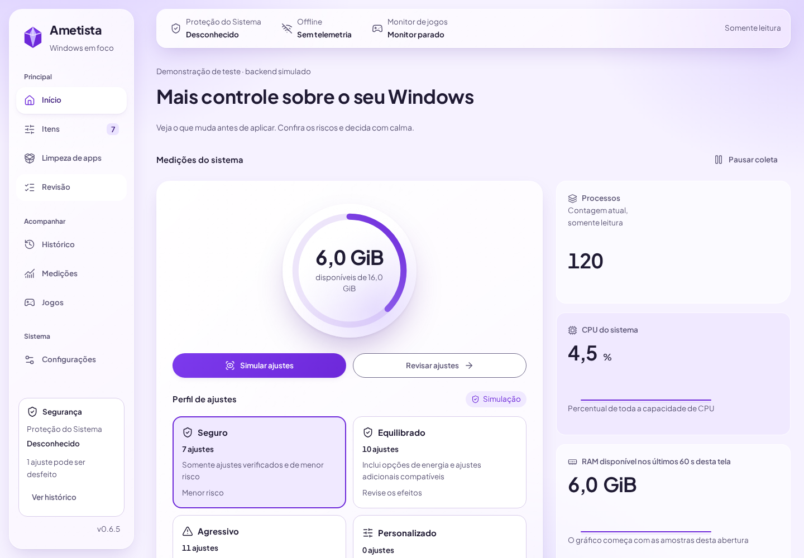
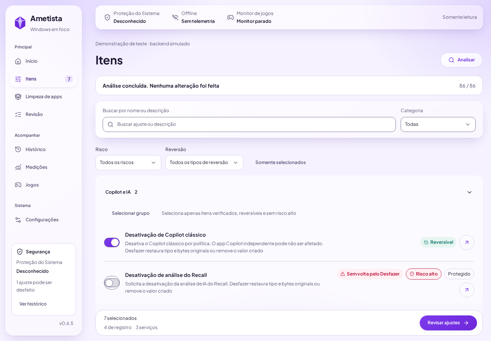
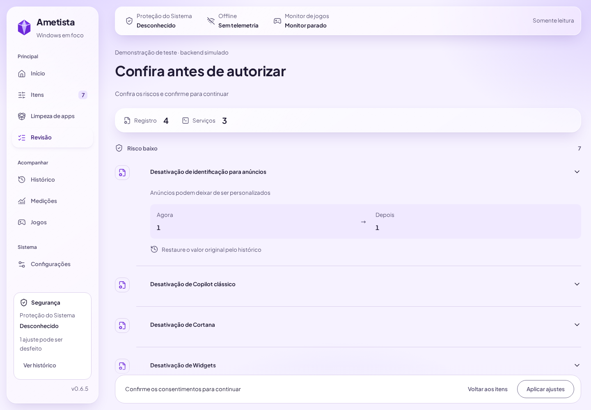
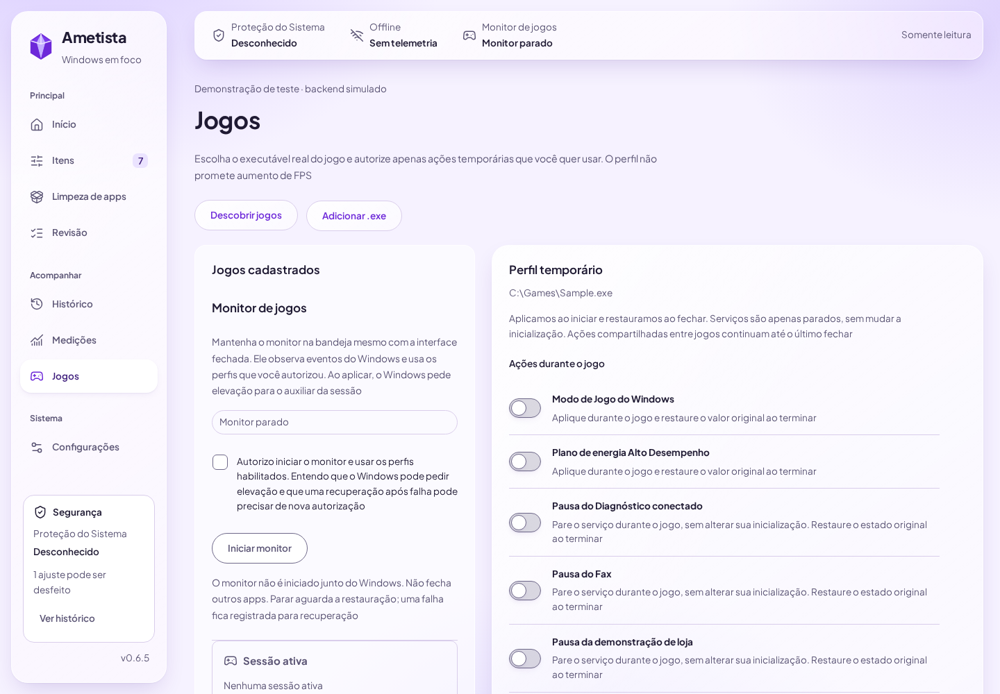

# Ametista

**0.6.5 alpha — test in a disposable VM with a checkpoint. Do not use on your main PC.**

[Português](README.md) · [Documentation](docs/README.md) · [Recovery](docs/user/recovery.en.md) · [Security](SECURITY.md)

Ametista is an offline Windows desktop app for reviewing gaming-related system settings. It explains changes and risks and shows measured results. Simulate first, then review before applying. Journaled settings can be undone. **App removal is a separate manual action: Undo does not reinstall apps or recover their data.**

No account, telemetry or FPS promises. It does not change Windows security protections, open game-process handles, inject code or use hooks.

## Interface

| **Home** <picture><source media="(prefers-color-scheme: dark)" srcset="docs/assets/screenshots/home-dark.png"></picture> | **Items** <picture><source media="(prefers-color-scheme: dark)" srcset="docs/assets/screenshots/items-dark.png"></picture> |
| --- | --- |
| **Review** <picture><source media="(prefers-color-scheme: dark)" srcset="docs/assets/screenshots/review-dark.png"></picture> | **Games** <picture><source media="(prefers-color-scheme: dark)" srcset="docs/assets/screenshots/games-dark.png"></picture> |

Screenshots show deterministic test-backend data in the pt-BR interface, not measurements from your PC. The app also supports English. [Light and dark images](docs/design/screenshots.md).

## Installation and basic use

Distribution is being prepared; there is no final signed installer. Build only inside a disposable Windows VM with a checkpoint and WebView2 using the [build guide](docs/dev/build.md). Check source, version and hashes through the [release process](docs/release-process.md). Drafts and historical v0.6.0 are not stable releases.

1. Open the UI as a standard user and select Safe
2. Select Simulate, then inspect items, risks and the review
3. Apply only in the VM with consent. Use History → Undo all to check restoration

Portable builds are for inspection/simulation. Applying requires a protected installation and VM acceptance. Do not launch the elevated helper directly. Game profiles use a separate Rust monitor that can stay running after the UI closes.

## If the PC behaves unexpectedly

Stop applying changes. Try Undo all from History. If needed, use an earlier System Restore point or Windows Recovery Environment when Windows cannot start. For a VM, restore its checkpoint. [Recovery guide](docs/user/recovery.en.md).

## Limits and license

Targets: Windows 10 22H2 and Windows 11 23H2+. Home/Pro, elevation under another account and reboot acceptance still require VM validation. NVDA/Narrator and high-DPI checks are pending. Store reinstallation may require internet and does not restore removed-app data.

Full effects are the default. The [final measurement](docs/performance.md) found 163.54 MiB for Full and 244.04 MiB for Reduced. Under policy v2 and the owner’s decision, Full is approved; Reduced is informational and exceeds the RAM ceiling. The monitor passed its strict limits. These are not FPS predictions.

[Apache-2.0](LICENSE) · [NOTICE](NOTICE) · [Contributing](CONTRIBUTING.md) · [Code of Conduct](CODE_OF_CONDUCT.md)
