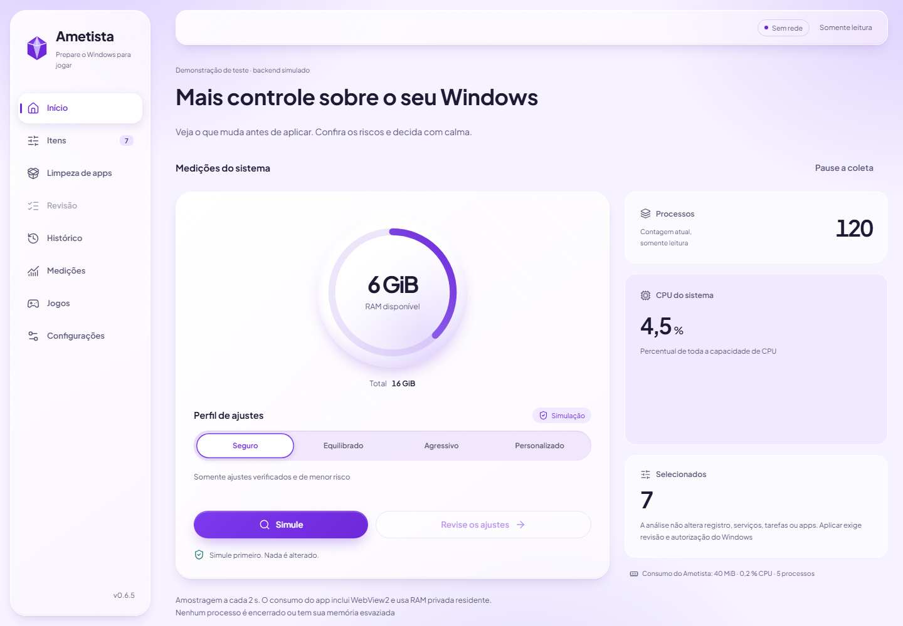
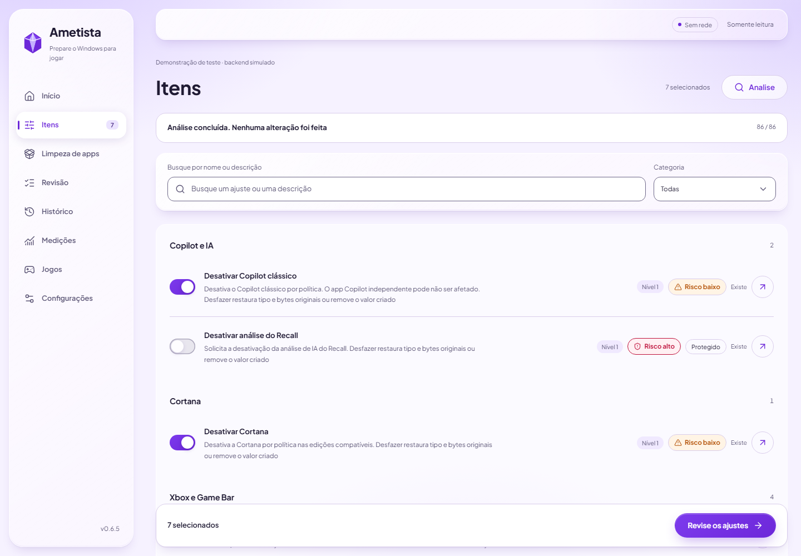
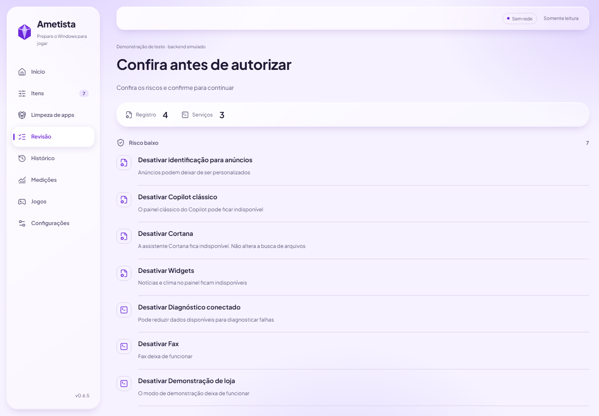
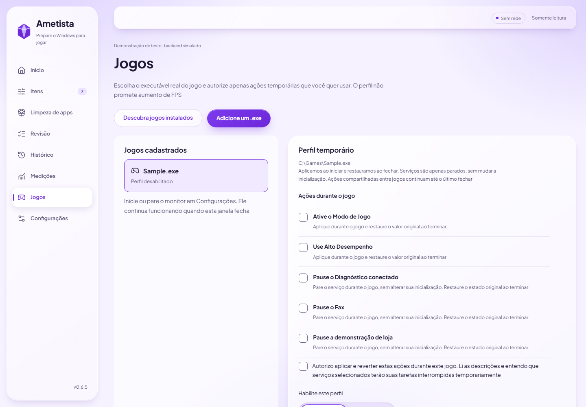

# Ametista

**0.6.5 alfa — teste em VM descartável com snapshot. Não use no PC principal.**

[English](README.en.md) · [Documentação](docs/README.md) · [Recuperação](docs/user/recovery.md) · [Segurança](SECURITY.md)

Ametista é um app desktop offline para revisar ajustes do Windows voltados a jogos. Mostra o que muda, os riscos e o resultado medido. Simule primeiro; aplique somente após a revisão. Configurações registradas podem ser desfeitas pelo journal. **Remover apps é uma ação manual separada: Desfazer não reinstala apps nem recupera seus dados.**

Sem conta, telemetria ou promessas de FPS. Não altera proteções do Windows, não abre handles em jogos e não usa injeção ou hooks.

## Veja a interface

| **Início** <picture><source media="(prefers-color-scheme: dark)" srcset="docs/assets/screenshots/home-dark.png"></picture> | **Itens** <picture><source media="(prefers-color-scheme: dark)" srcset="docs/assets/screenshots/items-dark.png"></picture> |
| --- | --- |
| **Revisão** <picture><source media="(prefers-color-scheme: dark)" srcset="docs/assets/screenshots/review-dark.png"></picture> | **Jogos** <picture><source media="(prefers-color-scheme: dark)" srcset="docs/assets/screenshots/games-dark.png"></picture> |

As imagens mostram dados de demonstração do backend de testes, não medições do seu PC. [Todas as capturas claras e escuras](docs/assets/screenshots/).

## Instalação e uso

A distribuição ainda está em preparação: não há instalador final assinado. Para avaliar, use o [guia de build](docs/dev/build.md) dentro de uma VM Windows com snapshot e WebView2. Confira a origem, a versão e os hashes conforme o [processo de release](docs/release-process.md). Não confunda um rascunho ou a tag histórica v0.6.0 com uma versão estável.

1. Abra a interface como usuário comum e escolha o perfil Seguro
2. Selecione **Simule** e confira os itens, os riscos e a revisão
3. Aplique somente na VM e com consentimento. Depois, use **Histórico → Desfaça tudo** para conferir a reversão

O portátil serve para análise/simulação; aplicação real exige instalação protegida e aceite em VM. Não abra o auxiliar diretamente. Perfis de jogos usam um monitor Rust separado; ele pode continuar com a janela fechada. [Como usar](docs/user/desktop.md).

## E se o PC ficar estranho?

Pare de aplicar ajustes. Tente **Desfaça tudo** no histórico. Se necessário, use um ponto anterior pela Restauração do Sistema; se o Windows não iniciar, consulte o Ambiente de Recuperação. Em VM, volte ao snapshot anterior. [Guia de recuperação](docs/user/recovery.md).

## Limitações e licença

Alvos: Windows 10 22H2 e Windows 11 23H2+. A matriz Home/Pro, UAC com outra conta e reinícios ainda precisam de aceite em VM. NVDA/Narrador e DPI alto têm validação manual pendente. Apps removidos podem precisar da Microsoft Store e de internet para reinstalar.

Completo é o padrão. O [gate por linha de base](docs/performance.md) passa no Completo neste host; Reduzido excede o teto mediano de RAM em 5,50 MiB. O monitor mantém limites estritos. Esses dados não são uma previsão de FPS.

[Apache-2.0](LICENSE) · [NOTICE](NOTICE) · [Contribuir](CONTRIBUTING.md) · [Código de Conduta](CODE_OF_CONDUCT.md)
